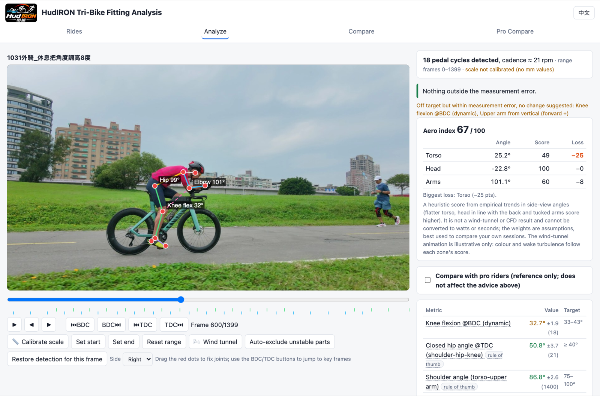
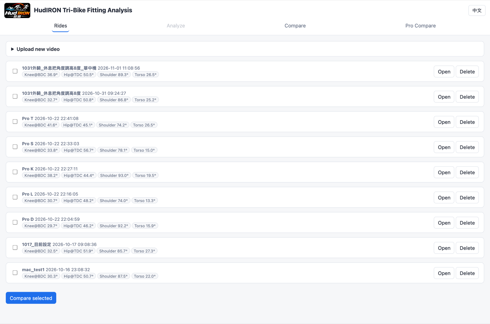
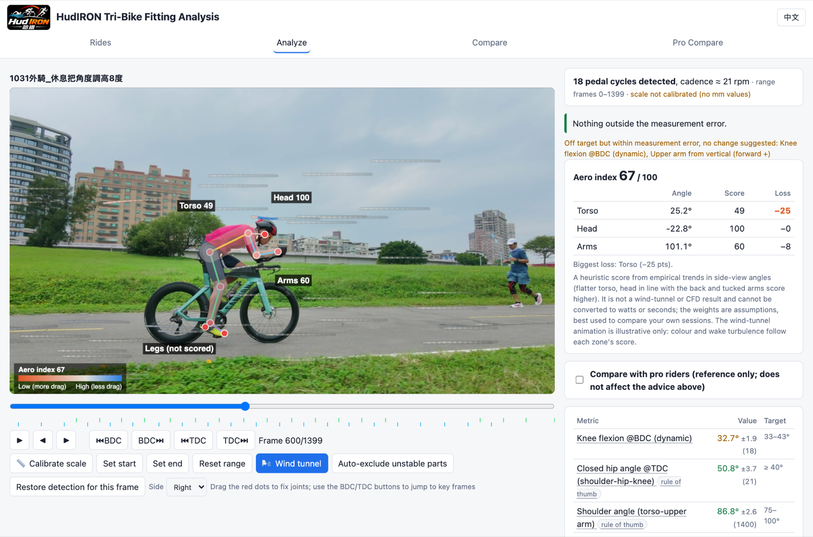
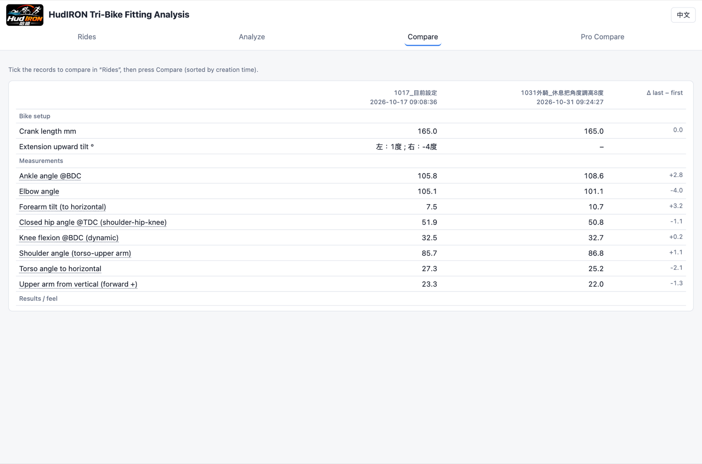
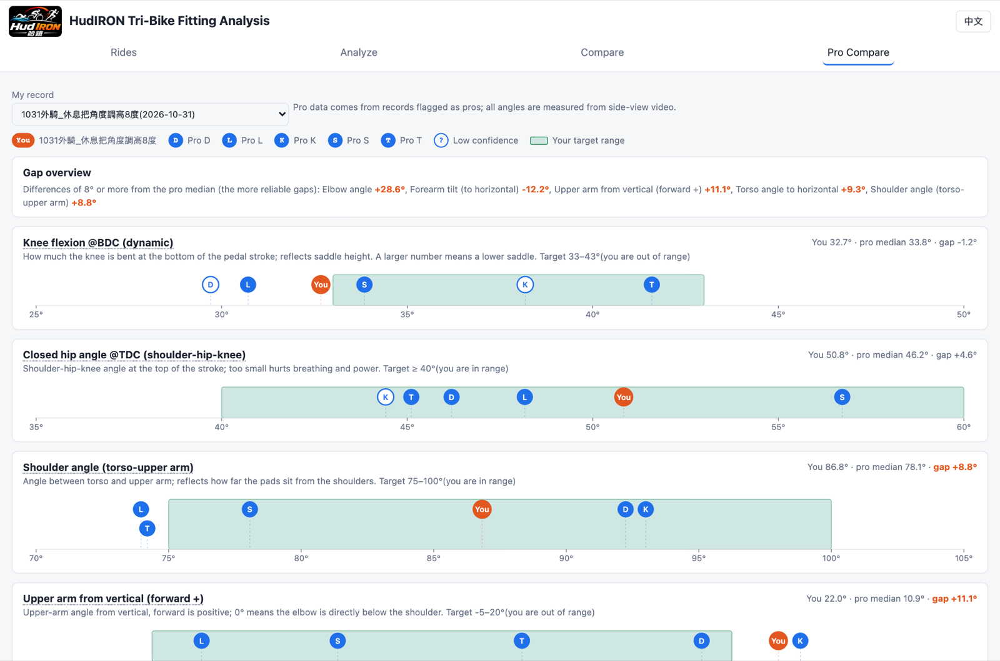

# HudIRON Tri-Bike Fitting Analysis

[繁體中文](README.md) | **English**

Analyze your tri-bike fit from a single **side-view video**, entirely on your own computer: pose detection → joint angles and distances → "fix this first" advice against target ranges → session-to-session comparison → an aero index with a wind-tunnel visualization. **Your videos and data never leave your machine.**

## Features
- **Pose detection** with MediaPipe; drag the red dots to correct joints, set a valid range, or auto-exclude unstable tracking segments in one click.
- **Angles & distances**: knee flexion (BDC), closed hip angle (TDC), shoulder, upper arm, forearm, torso angle, knee–elbow gap, etc.; millimetre values after scale calibration.
- **"Fix this first"**: compares against the target ranges in `ranges.json`; deviations smaller than the measurement error are not suggested. Change one variable at a time.
- **Compare** several sessions side by side (setup, angles, results).
- **Pro comparison (optional, off by default)**: upload pro-rider videos yourself and see the gap to their median on the analyze page (reference only; it does not affect the advice order).
- **Aero index + wind tunnel**: a 0–100 heuristic score from side-view angle trends, with colour and airflow animation per body zone. **It is not wind-tunnel or CFD output** — use it only to compare your own sessions.
- Chinese / English UI.

| Rides | Wind tunnel |
|---|---|
|  |  |
| **Compare** | **Pro comparison** (riders anonymized) |
|  |  |

## Install (one click)
1. **Code → Download ZIP** at the top of this page and unzip (or `git clone https://github.com/hudsonx1123/hud_iron_tribike_fitting`).
2. Run the installer:
   - **macOS**: right-click `install.command` in Finder → **Open** (Gatekeeper blocks a plain double-click the first time), or run `bash install.command` in Terminal.
   - **Windows**: double-click `install.bat` (if SmartScreen appears, choose *More info → Run anyway*).
3. The installer downloads an isolated Python 3.12 (your system Python is untouched, no admin rights needed), installs the packages (~300 MB), downloads the pose model (~30 MB, from Google MediaPipe) and creates a desktop shortcut. Your browser opens when it finishes.
4. Afterwards double-click **HudIRON** on the desktop (or `start.command` / `start.bat`). Default address: <http://localhost:5000> (another port is picked automatically if it's busy).

> Internet is needed only during installation. **Don't delete or move this folder** — your videos and results live in its `data/` directory.
> The Windows installer has not been verified on a real Windows machine yet; please report problems in Issues.

### Manual install
    python3.12 -m venv .venv
    .venv/bin/pip install -r requirements.txt        # Windows: .venv\Scripts\pip
    .venv/bin/python app.py                           # the pose model is fetched on first analysis

## Workflow
1. Upload a video (optionally fill in bike setup and results).
2. Open it, jump to key frames with the BDC/TDC buttons, drag the red dots to fix misplaced joints.
3. "Calibrate scale" with two points of known distance; use "Set start/end" to exclude unstable parts.
4. Read "Fix this first", change one variable, ride and upload again.
5. Compare sessions side by side; turn on "🌬 Wind tunnel" to see the drag trend.

### Filming tips (biggest impact on accuracy)
- Fixed camera at bike height, perpendicular to the bike, same position and distance every time.
- 8–20 s, steady cadence, plain background, fitted clothing; at least 5 pedal cycles.
- Include an object of known length (tyre diameter, wheelbase) in frame for scale calibration.

### Adding pro-rider comparison (optional)
This repository ships **no pro-rider videos or data**. To compare, upload side-view footage you have the right to use, then add `"pro": true` and `"short": "S"` (any label) to that session's `data/sessions/<id>/meta.json` and refresh the page. Make sure you are allowed to use that footage.

## Notes
- 2D pose estimation has ~3–9° error; deviations below that are not turned into advice. Targets are mostly rules of thumb (not validated standards) — edit `ranges.json` freely.
- This is a helper tool, not a substitute for a professional bike fitter; see a professional for pain or injury.
- Privacy: everything runs locally and nothing is uploaded. `data/` is not tracked by git.

## License
MIT — see [LICENSE](LICENSE) (the HudIRON logo and name are excluded; all rights reserved). Third-party components: [THIRD_PARTY_NOTICES.md](THIRD_PARTY_NOTICES.md).
