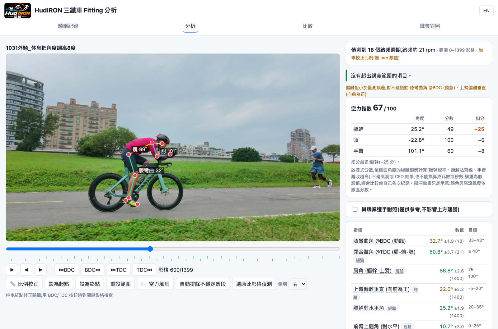
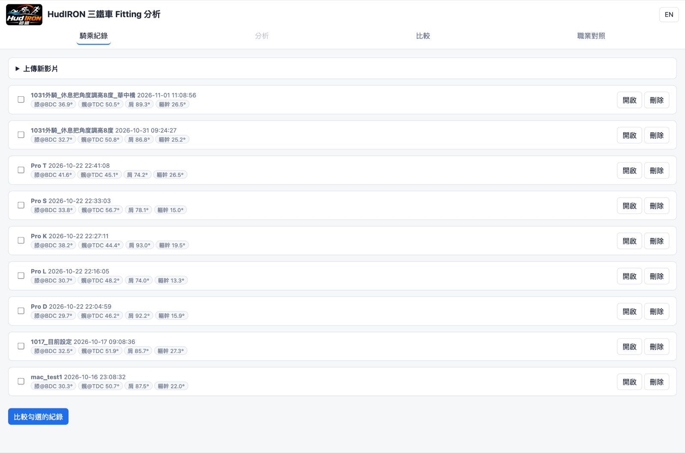
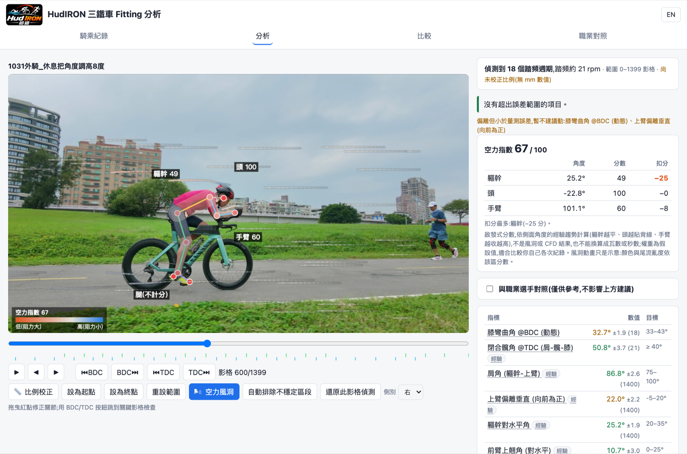
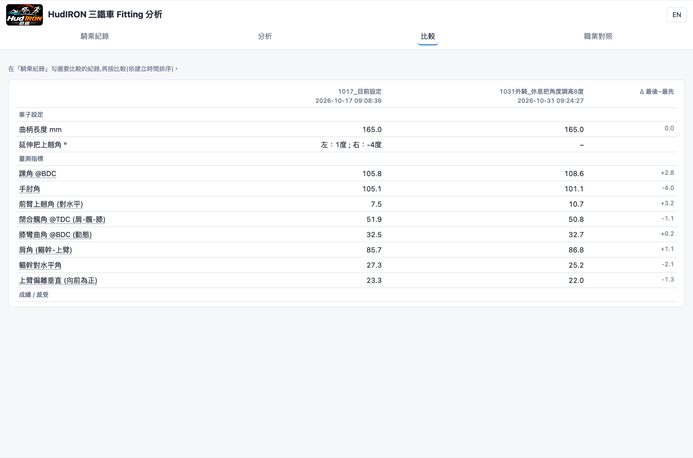
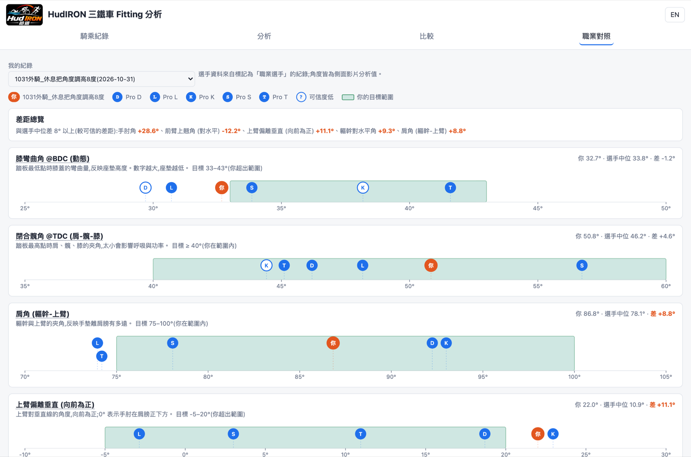

# HudIRON 三鐵車 Fitting 分析

**繁體中文** | [English](README.en.md)

用一支**側面騎乘影片**,在你自己的電腦上分析三鐵車 fitting:姿態偵測 → 標註角度與距離 → 對照目標範圍給出「先修哪一項」→ 跨次比較 → 空力指數與風洞視覺化。**影片和資料都不會離開你的電腦。**

## 功能
- **姿態偵測**:MediaPipe 自動標出關節,可拖曳紅點修正;可設定有效區段,或一鍵「自動排除不穩定區段」。
- **角度與距離**:膝彎曲(BDC)、閉合髖角(TDC)、肩角、上臂、前臂、軀幹角、膝-手肘間距等;比例校正後有 mm 數值。
- **先修這個**:對照 `ranges.json` 的目標範圍,小於量測誤差的偏離不會列入建議;一次只改一個變數。
- **前後比較**:勾選多次紀錄並排比較設定、角度與成績。
- **職業對照(選用,預設關閉)**:你自己上傳選手影片,即可在分析頁看到與選手中位數的差距(僅供參考,不影響建議順序)。
- **空力指數 + 風洞**:依側面角度趨勢算出 0–100 的啟發式分數,並用顏色與氣流動畫標出各部位。**這不是風洞或 CFD 的結果**,只適合比較你自己的各次紀錄。
- 中文 / English 介面切換。

| 騎乘紀錄 | 空力風洞 |
|---|---|
|  |  |
| **前後比較** | **職業對照**(選手已代號化) |
|  |  |

## 安裝(一鍵)
1. 到本頁右上角 **Code → Download ZIP** 下載並解壓縮(或 `git clone https://github.com/hudsonx1123/hud_iron_tribike_fitting`)。
2. 執行安裝程式:
   - **macOS**:在 Finder 對 `install.command` 按右鍵 → **打開**(第一次會被 Gatekeeper 擋,選「打開」)。或在終端機執行 `bash install.command`。
   - **Windows**:雙擊 `install.bat`(若出現 SmartScreen,選「其他資訊 → 仍要執行」)。
3. 安裝程式會自動:下載獨立的 Python 3.12(不動你系統的 Python,不需要管理員權限)、安裝套件(約 300 MB)、下載姿態模型(約 30 MB,來自 Google MediaPipe),並在桌面建立捷徑。完成後會自動開啟瀏覽器。
4. 之後雙擊桌面的 **HudIRON**(或 `start.command` / `start.bat`)即可使用;預設網址 <http://localhost:5000>(被占用時自動換埠)。

> 需要網路(只有安裝時)。請**不要刪除或搬動這個資料夾**:你的影片與分析結果都存放在裡面的 `data/`。
> Windows 安裝腳本尚未在實機上驗證,遇到問題請到 Issues 回報。

### 手動安裝
    python3.12 -m venv .venv
    .venv/bin/pip install -r requirements.txt        # Windows: .venv\Scripts\pip
    .venv/bin/python app.py                           # 第一次分析時會自動下載姿態模型

## 使用流程
1. 上傳影片(可同時填車子設定與成績)。
2. 開啟後用 BDC/TDC 按鈕跳到關鍵影格,拖曳紅點修正偏掉的關節。
3. 「比例校正」點兩個已知距離的點;用「設為起點/終點」排除不穩定區段。
4. 看右側「先修這個」,一次只改一個變數,再騎一次上傳。
5. 「比較」頁並排看變化;想知道風阻趨勢就打開「🌬 空力風洞」。

### 拍攝建議(影響準確度最大)
- 手機/相機固定,鏡頭與車子同高、正對車側,每次同樣位置與距離。
- 8–20 秒、穩定踏頻、背景單純、衣服貼身;至少 5 個踏頻週期。
- 畫面中放一個已知長度(輪胎外徑、軸距)做比例校正。

### 加入職業選手對照(選用)
本專案**不附任何選手影片或資料**。想要對照的話,自行上傳你有權使用的選手側面影片,再把該筆紀錄的 `data/sessions/<id>/meta.json` 加上 `"pro": true` 與 `"short": "代號"`(例如 `"short": "S"`),重新整理頁面即可。請確認你有該影片的使用權。

## 注意事項
- 2D 姿態估計誤差約 3–9°,小於誤差的偏離不會被當成建議;目標範圍多為經驗法則(非驗證標準),可自行修改 `ranges.json`。
- 這是輔助工具,不能取代專業 bike fitter;有疼痛或傷病請諮詢專業人員。
- 隱私:所有處理都在本機,沒有任何資料上傳。`data/` 不會被 git 追蹤。

## 授權
MIT,見 [LICENSE](LICENSE)(HudIRON logo 與名稱除外,保留所有權利)。第三方元件見 [THIRD_PARTY_NOTICES.md](THIRD_PARTY_NOTICES.md)。
